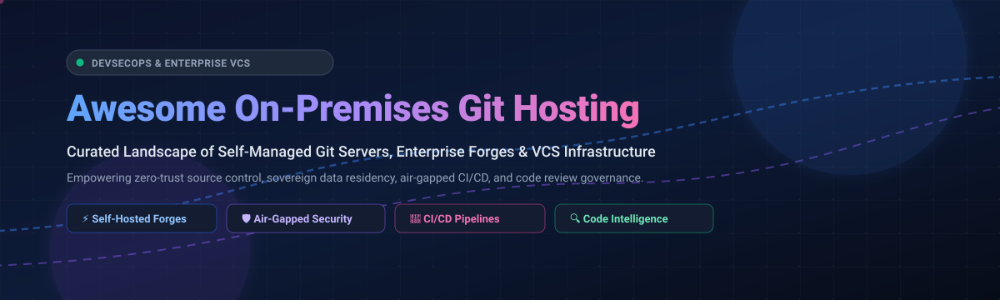

# 🌟 Awesome On-Premises Git Repository Hosting

  

  
  
  
  
  

---

## 🧭 Overview & Mission

Welcome to the definitive **Awesome On-Premises Git Repository Hosting** directory! 🚀 A carefully curated index of enterprise-ready, self-managed Git forges, private source code servers, code review engines, and VCS developer infrastructure.

Whether maintaining compliance in defense, healthcare, banking, or telecommunications, organizations require reliable on-premises Git infrastructure to ensure **sovereign data residency**, zero-trust security boundaries, air-gapped CI/CD execution, and elimination of unpredictable cloud per-seat licensing.

---

## 📊 Sector Overview & Market Dynamics

> The global Version Control Systems (VCS) and Source Code Management (SCM) market is estimated at **$6.2 Billion to $8.5 Billion**, projected to reach **over $16 Billion by 2032** growing at a CAGR of ~11.8%.
> 
> The sector is **concentrated and oligopolistic** (winner-take-most dynamics dominated by Microsoft/GitHub, GitLab, and Atlassian Bitbucket), while maintaining a vibrant, battle-tested open-source ecosystem (Gitea, OneDev, Gerrit, Gogs) that provides high-performance sovereign alternatives for cost-conscious, security-critical, and air-gapped enterprise environments.

---

## 📑 Table of Contents

- [📊 Sector Overview & Market Dynamics](#-sector-overview--market-dynamics)
- [🏢 Enterprise & SaaS Platforms (Self-Managed / On-Prem)](#-enterprise--saas-platforms-self-managed--on-prem)
- [⚡ Open-Source GitHub Projects](#-open-source-github-projects)
- [🤝 How to Contribute](#-how-to-contribute)
- [⭐ Star History](#-star-history)
- [💖 Support & Sponsorship](#-support--sponsorship)
- [⚖️ Disclaimer](#️-disclaimer)

---

## 🏢 Enterprise & SaaS Platforms (Self-Managed / On-Prem)

The leading commercial Git hosting solutions for enterprise self-managed, VPC, and on-premises deployments, sorted by **parent company valuation and scale**:

| Platform / Product | Company Valuation / Revenue | Starting Pricing Tier | Free Tier Limits / Trial | Key Capabilities & Target Fit |
| :--- | :--- | :--- | :--- | :--- |
| **[GitHub Enterprise Server](https://github.com/enterprise)** | **~$3.0+ Trillion Market Cap** (Microsoft parent) / ~$2B ARR | **$21/user/month** (Enterprise plan, billed annually) | **45-day free trial** for up to 50 seats with full Enterprise Server feature set | Full GitHub workflow self-hosted in your datacenter or private cloud. Includes GitHub Actions CI/CD, advanced pull requests, package registry, GitHub Advanced Security (GHAS) add-on, and SAML/SCIM SSO. |
| **[Bitbucket Data Center](https://www.atlassian.com/software/bitbucket/enterprise)** | **~$45+ Billion Market Cap** (Atlassian) / ~$4.3B Revenue | **$5,400/year** (Starting tier for 25 users; ~$18/user/month) | **30-day free trial** for Data Center instances with unlimited repository access | Clustered active-active high availability, enterprise Disaster Recovery, merge queues, smart mirroring for global dev teams, and deep Atlassian Jira/Confluence integration. |
| **[GitLab Enterprise (Self-Managed)](https://about.gitlab.com/pricing/)** | **~$7.5+ Billion Market Cap** / ~$650M ARR | **$29/user/month** (Premium tier, billed annually) | **30-day free trial** of Ultimate with all security scanners and compliance tools | Complete unified DevSecOps platform with source code management, robust CI/CD runners, container registry, compliance frameworks, dynamic environment management, and Duo AI assistance. |
| **[RhodeCode Enterprise](https://rhodecode.com/pricing)** | **~$15M+ Valuation** (Private / Bootstrapped Enterprise) | **$75/user/year** (~$6.25/user/month, minimum 10 users) | **Free Community Edition** forever for up to 10 users with full Git, SVN, and Mercurial support | Unified source control management across Git, Subversion (SVN), and Mercurial in a single platform with code review, pull request dependencies, and LDAP/AD integration. |

---

## ⚡ Open-Source GitHub Projects

*Sorted by GitHub Star count in descending order.*

- **[Gitea](https://github.com/go-gitea/gitea)**   
  ☕ The leading lightweight open-source Git forge (MIT). Shipped as a single Go binary with a built-in web UI, issue tracking, pull requests, wikis, package registry, and Gitea Actions (GitHub Actions-compatible CI). Idles at ~100MB RAM—the lightest full-featured option with minimal operational overhead.

- **[Gogs](https://github.com/gogs/gogs)**   
  ⚡ A painless, self-hosted Git service written in Go (MIT). Extremely lightweight and cross-platform with minimal resource consumption, providing core repository management, issue tracking, and web interface.

- **[GitLab (Self-Managed Free)](https://github.com/gitlabhq/gitlabhq)**   
  🦊 The open-source core of GitLab (MIT for community edition code). Provides comprehensive source code management, code reviews, merge requests, issue tracking, and integrated CI/CD pipelines in a complete DevOps lifecycle platform.

- **[OneDev](https://github.com/theonedev/onedev)**   
  🛠️ An all-in-one open-source DevOps platform and Git server (MIT). Features GUI-friendly CI/CD build pipelines with Kubernetes/Docker support, deep code intelligence (symbol search and outline navigation), pull requests, and custom issue boards.

- **[GitBucket](https://github.com/gitbucket/gitbucket)**   
  ☕ A GitHub clone powered by Scala and JVM (Apache 2.0). Provides a highly compatible GitHub-like UI and API, repository viewer, issues, pull requests, wiki, and plugin architecture, easily distributable as a single runnable WAR/Java file.

- **[Gitolite](https://github.com/sitaramc/gitolite)**   
  🔒 An extremely mature, lightweight access control layer on top of bare Git (GPL-2.0). Provides fine-grained access control down to branch and tag level over SSH without the overhead of a web server or database.

- **[Soft Serve](https://github.com/charmbracelet/soft-serve)**   
  🍦 A mighty, self-hostable Git server designed for the command line (MIT). Built by Charmbracelet with SSH-based interactive TUI menus, access control via SSH keys, web UI/TUI browsing, and Git LFS support.

- **[GitList](https://github.com/klaussilveira/gitlist)**   
  🐘 An elegant, modern Git repository viewer written in PHP (BSD-3-Clause). Allows browsing repositories, commit logs, file history, diffs, and trees with zero database requirements.

- **[CodeFever Community Edition](https://github.com/PGYER/codefever)**   
  🔥 A complete open-source self-hosted Git service platform (MIT). Features high performance, code hosting, code review, branch protection, and single-command deployment with Docker.

- **[Gitblit](https://github.com/gitblit-org/gitblit)**   
  ☕ An open-source, pure Java stack for managing, viewing, and serving Git repositories (Apache 2.0). Operates as a standalone server or WAR file with integrated user management, access control, tickets, and federation.

- **[Bonobo Git Server](https://github.com/jakubgarfield/Bonobo-Git-Server)**   
  🪟 A dedicated self-hosted Git server for Windows environments (MIT). Built on ASP.NET MVC and IIS, offering web-based repository management, user/team permissions, and Active Directory integration.

- **[Gerrit Code Review](https://github.com/GerritCodeReview/gerrit)**   
  🔍 The industry standard for rigorous, review-first Git workflows (Apache 2.0). Enforces formal change-based code review before merge with fine-grained ACL permissions and continuous integration verification.

- **[GitPrep](https://github.com/yuki-kimoto/gitprep)**   
  🐪 A portable GitHub clone written in Perl (Artistic License 2.0). Features an easy zero-configuration setup, web interface, pull requests, issue tracking, and repository permissions without requiring separate database engines.

- **[klaus](https://github.com/jonashaag/klaus)**   
  🐍 A zero-configuration, minimalist Git web viewer written in Python (Flask) under the ISC license. Offers syntax highlighting, commit history, blame views, and markdown rendering with simple WSGI/Docker deployment.

- **[Pagure](https://github.com/Pagure/pagure)**   
  🎩 A lightweight, fully open-source Git-centric forge written in Python (GPLv2+), developed by the Fedora Community. Offers issue tracking, pull requests, docs, and git-backed metadata storage.

- **[Apache Allura](https://github.com/apache/allura)**   
  🪶 An open-source software forge platform (Apache 2.0) managing Git repositories, SVN, Mercurial, issue tracking, markdown wikis, forums, and discussion spaces.

- **[RhodeCode Community Edition](https://github.com/rhodecode/rhodecode-enterprise-ce)**   
  🛡️ Enterprise-grade Git and Mercurial repository management platform. Features unified code review, pull request dependencies, and fine-grained repository access controls.

**💡 Architecture & Deployment Guidance**:
- For a **lightweight, single-binary Git server with minimal memory consumption (~100MB RAM)**: [Gitea](https://github.com/go-gitea/gitea) or [Gogs](https://github.com/gogs/gogs).
- For an **integrated DevOps platform with native GUI CI/CD pipelines & code intelligence**: [OneDev](https://github.com/theonedev/onedev) or [GitLab Self-Managed](https://github.com/gitlabhq/gitlabhq).
- For a **terminal-first, keyboard-centric SSH Git server**: [Soft Serve](https://github.com/charmbracelet/soft-serve).
- For **pure SSH access control without web server baggage**: [Gitolite](https://github.com/sitaramc/gitolite).
- For **formal, change-based pre-commit code review gates**: [Gerrit Code Review](https://github.com/GerritCodeReview/gerrit).

---

## 🤝 How to Contribute

Contributions are warmly welcomed! Help us keep this directory comprehensive and up to date:

1. 🍴 **Fork** this repository.
2. 🌿 Create a feature branch: `git checkout -b add-git-forge`.
3. 📝 Add or update an entry following the existing markdown table or list format.
4. 🔗 Include official documentation and repository links.
5. 🚀 Submit a **Pull Request** with a concise description of your changes.

---

## 📈 Star History

---

## 💖 Support & Sponsorship

Thank you for checking out **Awesome On-Premises Git Repository Hosting**! If you find this directory valuable for your organization, team, or personal infrastructure, please consider:

- ⭐ **Starring** the repository on GitHub.
- 🍴 **Forking** and contributing new tools or fixes.
- 📢 **Sharing** with your network, platform engineers, and DevOps communities.
- ☕ **Sponsoring or Buying a Coffee**: Support ongoing open-source maintenance via the [GitHub Sponsors Dashboard](https://github.com/sponsors/ishandutta2007).

---

## ⚖️ Disclaimer

- This curated list is maintained for educational and informational purposes; inclusion does not constitute commercial endorsement.
- Self-hosted source control infrastructure requires strict adherence to security patching, encrypted backup management, access token rotation, and vulnerability tracking. Always review security advisories prior to production deployment.
- Product logos, trademarks, and registered names belong to their respective corporate owners.

---

  <b>Built with ❤️ for platform engineers, DevOps architects, and open-source advocates worldwide.</b>

